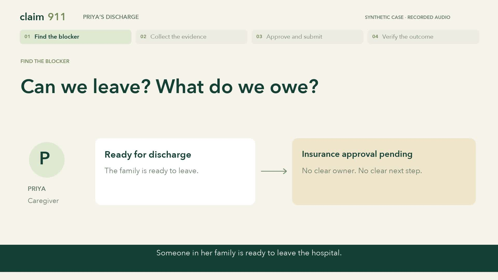
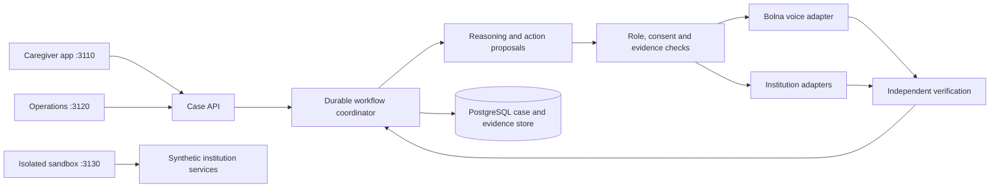

# Claim911

**Voice-led coordination for a hospital discharge stuck on “insurance approval pending.”**

Claim911 helps a caregiver find the actual blocker, coordinate hospital departments and the claims administrator, approve an exact document packet, and understand an independently verified outcome. Bolna is the Claim911 voice assistant.

## Watch the demonstration

[](demo/video/Claim911_Demo_V2.mp4)

- **[Latest demo video, 3:59](demo/video/Claim911_Demo_V2.mp4)**
- **[Successful demo audio recordings and transcripts](demo/successful-audio-recordings/README.md)**
- [Video script](demo/video/SCRIPT.md) · [Captions](demo/video/Claim911_Demo_V2.srt)
- [Completed-case evidence](demo/evidence/completed-run.json) · [Video provenance](demo/video/edit_manifest.json)

To use the chaptered video player and audio library locally, clone this repository, run `python -m http.server 8080` from its root, and open `http://localhost:8080/demo/video/`. Playing the saved media requires no provider keys or new calls.

The case and counterparties are synthetic. Call excerpts preserve the actual Bolna assistant recordings. The new narrator is separate from those calls. Caregiver interface footage is a labeled walkthrough using isolated fixtures.

## The case

A patient is medically ready for discharge, but the family does not know why final insurance clearance is pending. Billing has corrected a duplicate charge. The insurance desk has an old bill. The discharge summary needs a signature. Another department holds the implant invoice. The TPA, the third-party claims administrator, has an outstanding document query, and the enhancement request is not linked.

Claim911 follows the responsible desks, collects and checks the evidence, recovers the unsigned-summary delay, obtains exact sharing permission, asks the hospital to submit, and independently verifies receipt, query resolution, insurer authorization and hospital reconciliation.

The demonstrated outcome is administrative discharge clearance, a ₹2,48,000 bill, ₹2,30,000 insurer payable, ₹18,000 patient share, a ₹30,000 deposit, zero balance due and ₹12,000 refund due. **Refund payment remains unverified.** Claim911 does not issue clinical decisions, insurance authorizations or payments.

## Architecture



The caregiver interface, operations controller and sandbox have separate roles and authorization scopes. Sandbox cases, credentials and institution signing material are separated from operational data. Package workers use restricted filesystems and egress. Conversations can report facts; protected writes and completion gates require permitted institution operations and independently checked evidence.

## Repository map

| Path | Contents |
|---|---|
| `coordinator/` | Workflow, policies, permissions, scoped voice tools and evidence handling |
| `experience/` | Caregiver, operations and sandbox API boundaries |
| `product/` | Next.js caregiver, operations and sandbox interfaces |
| `simulator/` | Synthetic hospital, TPA and insurer services and schemas |
| `sandbox/` | Role participants, scenario runner, checkpoints and isolated provider workers |
| `scripts/` | Bootstrap, local checks, controlled runs and reconciliation |
| `tests/` | Domain, authorization, recovery, media and environment contracts |
| `fixtures/` | Synthetic scenario and speech fixtures |
| `dashboard/` | Earlier controller interface retained for compatibility |
| `demo/successful-audio-recordings/` | 13 finalized conversations, transcripts and hashes |
| `demo/evidence/` | 13 checkpoint verifications and completed-case summary |
| `demo/video/` | Latest video, poster, captions, script and portable edit manifest |

## Setup

The recorded implementation used Python 3.14, Node.js 24, PostgreSQL and Docker for isolated provider workers. Python and JavaScript dependencies are pinned in the included requirements and lockfiles.

1. Create a Python virtual environment and install `requirements.txt`.
2. Follow [local reproduction](docs/LOCAL_REPRODUCTION.md) to generate your own private runtime profiles and separate operational/sandbox storage.
3. Install frontend dependencies with `pnpm install --frozen-lockfile` in `product/`, then run `pnpm build`.
4. Start the product API and the three interfaces using [the product setup guide](product/README.md).
5. Configure your own Bolna and optional Azure credentials only in private runtime configuration when you need live provider integration. See [the voice runbook](docs/VOICE_RUNBOOK.md).

Runtime profiles, provider keys, database contents, session tokens, verified phone numbers and institution private signing keys are intentionally absent. The bootstrap scripts generate new local credentials. The saved demo does not require live provider access.

## Validation and limits

The included evidence records **one completed 13-checkpoint synthetic case**, with reviewed resumptions and independently checked institution state. There are 11 voice stages; exact packet approval and receipt verification are non-call checkpoints. The records stage includes pending-signature conversations followed by the released-summary follow-up.

This is not a claim of three consecutive fresh runs, uninterrupted execution, general production readiness or a fresh-machine installation test. Hindi is deferred. The recorded sandbox result is distinct from historical telephone tests. Live operational automation still requires its own configured and reviewed deployment.

For local checks without provider access:

```bash
python scripts/check_simulator_local.py
cd product
pnpm test:voice-contracts
pnpm test:voice-archive
```

The local simulator preflight denies network access. These checks supplement the saved voice evidence; they do not reproduce live Bolna behavior.

## Public release hygiene

Only source, pinned dependencies, synthetic fixtures, selected documentation and finalized demonstration media are included. Private runtime data, secrets, databases, installed packages, caches, failed attempts, earlier cuts and raw account screenshots are excluded. `.gitignore` and the default Gitleaks rules protect future commits; the single narrow scanner exception is a known non-secret dynamic-variable field name.

Third-party license notices remain with their components. Narration and media provenance are documented in [production notes](demo/video/PRODUCTION_NOTES.md).
