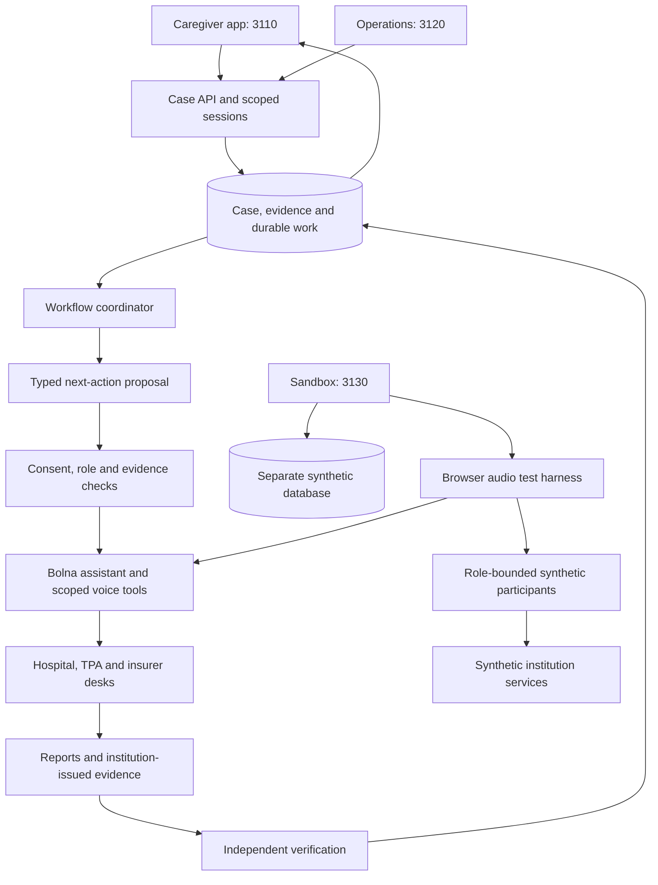

# Claim911 architecture through one discharge case

All institutions and case details in the demonstration are synthetic. This document describes the intended complete system and identifies unfinished integration explicitly.

## Problem and result

The caregiver knows only that discharge is delayed. Relevant facts sit with different owners: corrected bill with billing, signed summary with medical records, implant invoice with the store, document query with the TPA and coverage decision with the insurer.

Claim911 coordinates that dependency chain. Completion means institution-issued administrative clearance and an evidence-backed financial explanation. A refund due remains different from a verified refund payment.

## System boundaries

The diagram includes the intended coordination path. **General autonomous operational dispatch is not connected.** The caregiver API reports that limitation. The sandbox has a separate workflow runner; a fully verified Bolna run through that runner is still pending.

## Responsibilities in the case

| Layer | Concrete job | Boundary |
|---|---|---|
| Conversation reasoning | Bolna asks the hospital which final request is pending, clarifies references and invokes scoped tools | A spoken claim cannot authorize disclosure or verify an outcome |
| Next-action proposals | The current deterministic planner selects the next eligible checkpoint from observed case state | It is not a separate model-driven multi-agent planner |
| Control | Recheck consent, role, case, current context and exact packet approval | Neither Bolna nor a participant can grant its own authority |
| Durable coordination | Preserve dependencies, callback time, original query receipt, retry attempts and uncertain state | A lost execution cannot be retried blindly |
| Evidence | Keep reported facts, uploaded documents and verified institution records distinct | An upload or a convincing conversation is not a verified receipt or decision |
| Institutions | Hospital submits; TPA acknowledges and links; insurer decides; billing reconciles | Institution credentials and signing keys remain outside the assistant |
| Caregiver presentation | Show the current gate, permissions, documents and outcome in plain language | No scenario controls, routing knobs or operator credentials |

## Walkthrough

1. Caregiver intake records the concern and investigation permission.
2. Hospital conversation establishes distinct admission, initial, enhancement and final references.
3. Claims conversation discovers the outstanding query and exact document requirements.
4. Separate tasks obtain the corrected bill, signed summary and implant invoice. Missing signature produces a bounded follow-up rather than a fabricated document.
5. Independent document checks bind patient, admission, document reference and revision. A wrong or old document blocks progress.
6. Caregiver approves the exact packet and recipient. A later packet change invalidates approval.
7. Hospital submits. Dispatch is recorded, but receiving-side receipt remains unconfirmed.
8. The receiving institution independently confirms the exact packet. Query closure and enhancement linkage are checked separately.
9. Insurer issues a signed decision. The assistant explains it but does not choose coverage or amount.
10. Hospital billing reconciles bill, authorization and deposit. The caregiver sees clearance or remaining balance and refund due or payment status separately.

## Simulator structure

The same participant logic can run through a text-only boundary with controlled model/tool responses. Local tests need no recognizer, speech synthesis or model judge. They test the simulator's contracts, not actual model behavior.

For provider tests, adaptive participants still use their own role record and eligible institution operations. Bolna remains the only Claim911 assistant. Observed question text comes from Bolna when available; otherwise the live audio recognizer remains necessary. Generated participant replies then enter the separate speech stage.

A failed speech operation retains its reply without repeating participant generation or institution work. Uncertain generation stops the session for reconciliation. Failure evidence identifies recognition, generation, synthesis, validation or media handoff. No local reply cache establishes audio delivery or workflow completion.

The automated runners execute a network-denied pytest preflight before constructing their provider adapter. Passing it does not override suspended spending or constitute voice admission. Provider model evaluation, audio checks, independent case verification and human listening remain separate.

## Isolation and operating limits

Caregiver, operations and sandbox use separate origins and session scopes. Sandbox and operational records use separate database credentials. Package workers retain their network/filesystem restrictions; the trusted provider adapter uses restricted egress. These are explicit boundaries, not a test-mode checkbox.

Existing Bolna credits and the approved Azure ceiling are the only paid resources authorized. No top-up, paid fallback or repeat telephone testing is part of the demonstration. Paid testing is currently stopped. Hindi is deferred.
